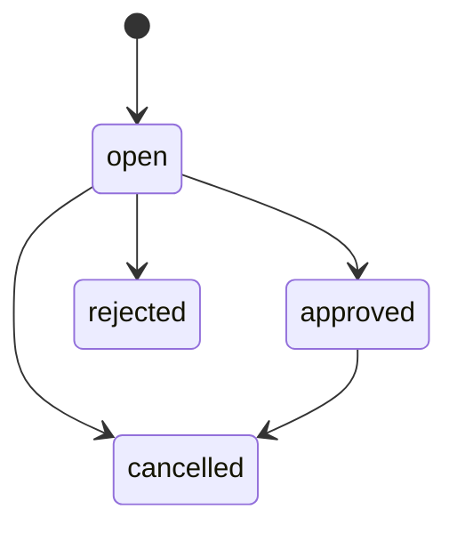

# Self-Hosted AI Coding Agent Platform — Vollständige technische Konzeption

> **Anwendungsstand 0.5.0 · Zielarchitektur und Roadmap, keine produktiv einsatzbereite Agentenplattform.** Das aktuelle Compose-Projekt stellt lediglich FastAPI, eine statische Startseite, PostgreSQL, Redis sowie optionale Ollama-/Gitea-Dienste bereit. Alles als *geplant* Kennzeichnete existiert noch nicht als lauffähige Funktion.

# Maintenance Task Management (v0.4.0)

## Arbeitsablauf

1. Gitea-Repositories über `POST /api/v1/repositories/sync` synchronisieren.
2. Ein Repository mit `POST /api/v1/repositories/{id}/analyze` lesend analysieren.
3. Wartungskandidaten über `POST /api/v1/tasks/import/{id}` importieren.
4. Aufgaben im Dashboard unter http://127.0.0.1:45000 sichten.
5. Tasks freigeben oder ablehnen. **Freigabe startet keinen Coding Agent.**

## Datenmodell

| Tabelle | Zweck |
|---|---|
| `schema_migrations` | Versionen der Datenbankstruktur |
| `maintenance_tasks` | Deduplizierte Wartungsaufgaben mit Repository, Priorität, Risiko, Akzeptanzkriterien und Status |
| `maintenance_task_events` | Unveränderliche Historie aller Statusänderungen |

Wartungsbefunde erhalten deterministische SHA-256-Fingerprints. Derselbe Befund wird nicht mehrfach als neuer Task angelegt. Bereits entschiedene Tasks werden durch einen erneuten Import nicht zurückgesetzt.

## API

| Methode | Route | Zweck |
|---|---|---|
| GET | `/api/v1/tasks` | Liste, optional `?status=open` |
| POST | `/api/v1/tasks/import/{id}` | Wartungsbefunde aus gespeichertem Analysebericht importieren |
| PATCH | `/api/v1/tasks/{id}/status` | Status mit JSON `{"status":"approved","reason":"Reviewed"}` ändern |
| GET | `/api/v1/tasks/{id}/history` | Audit-Historie anzeigen |

Alle Task-Endpunkte verlangen `X-Admin-Key`; der Wert stammt aus `ADMIN_API_KEY` in `.env`. Die UI fordert den Schlüssel pro Browser-Seite an und persistiert ihn nicht. Der Zugriff bleibt auf den lokalen Host beschränkt. Für echten Mehrbenutzerbetrieb sind rollenbasierte Sessions und CSRF-Schutz noch erforderlich.

## Zulässige Zustände



`approved` bedeutet ausschließlich zur späteren Bearbeitung freigegeben. Kein Git-Push, Docker-Run oder Agenten-Job wird ausgelöst.

## Migrationen

Das Backend verwendet ein versioniertes Migrationsregister unter PostgreSQL Advisory Lock, das bestehende Repository- und Analysedaten beibehält. Version 001: Katalog, 002: Analysen, 003: Maintenance Tasks und Audit. Rollback-Migrationen und eine eigenständige Migrations-CLI sind noch nicht enthalten.

## Grenzen und nächster Schritt

Diese Stufe nutzt weiterhin die vorhandene statische Dashboard-Oberfläche; **Nuxt 4 ist noch nicht integriert**. Noch offen sind Job-Queue, Redis-Worker, Sandbox-Executor, OpenCode, unabhängige Validierung, PR-Publisher und Mehrbenutzerberechtigungen. Die Aufgaben basieren auf heuristischen Befunden und stellen keinen CVE-Scan dar.

# Workflow-Orchestrator v0.5.0

## Funktionsumfang

Der eigenständige Compose-Service `orchestrator` verarbeitet **ausschließlich sichere Preflight-Runs** von zuvor freigegebenen Maintenance Tasks. Er führt weder Git-Befehle noch Coding Agents oder Repository-Code aus. Die Architektur trennt API, persistente Run-Historie und Worker.

- PostgreSQL ist das führende System für Run-Zustände und Audit-Ereignisse.
- Redis dient ausschließlich als schneller Wake-up-Hinweis (`agent-runs:wakeup`). Auch bei Redis-Ausfall sucht der Worker in der Datenbank nach wartenden Jobs.
- Maximal ein aktiver Run je Task durch einen partiellen Unique Index.
- `SELECT … FOR UPDATE SKIP LOCKED` verhindert gleichzeitige Übernahme desselben Runs durch mehrere Worker.
- Zustände: `queued → running → completed/failed/timed_out`; kein automatischer Git-Push.
- Der sichere Preflight ist ein Platzhalter; echte Agentenaufgaben folgen erst nach Implementierung isolierter Ausführung und unabhängiger Validation.

## API

Alle Endpunkte benötigen `X-Admin-Key` aus `.env`.

| Methode | Route | Funktion |
|---|---|---|
| GET | `/api/v1/runs` | Letzte 100 Runs |
| POST | `/api/v1/runs/task/{task_id}` | Freigegebenen Task zur Preflight-Prüfung einreihen |
| GET | `/api/v1/runs/{run_id}/events` | Nachvollziehbare Schrittereignisse |

Beispiel:

```bash
curl -X POST -H "X-Admin-Key: DEIN_ADMIN_API_KEY" \
  http://127.0.0.1:45001/api/v1/runs/task/1
curl -H "X-Admin-Key: DEIN_ADMIN_API_KEY" \
  http://127.0.0.1:45001/api/v1/runs
```

## Lokaler Start

```bash
git pull
just test
just build
just run
just ps
docker compose -f compose.yaml logs -f orchestrator
```

`orchestrator` hat keinen öffentlich zugänglichen Port, keine Docker-Socket-Mounts und keinen direkten Git-Schreibzugriff. Die Migration `004` legt `agent_runs` und `agent_run_events` an.

## Einschränkungen und nächste Phase

Die maximale Anzahl von Versuchen ist derzeit als Datenfeld erfasst, aber automatische Retries sind **noch nicht implementiert**. Bei Neustart werden vorher laufende Jobs zur Sicherheit als fehlgeschlagen markiert. Kein Task wird automatisch erneut ausgeführt. Der Worker ist zunächst für eine einzelne Instanz vorgesehen. Vor dem Einsatz mehrerer Worker müssen Lease-/Heartbeat-Regeln und eine differenzierte Recovery ergänzt werden.

Das bisherige Frontend ist weiterhin statisches HTML; eine vollständige Nuxt-4-Anwendung ist noch nicht implementiert. Auch echte Jobdauer/Timeout-Tests gegen PostgreSQL und Redis sowie Docker-End-to-End-Prüfungen sind noch ausstehend.

## 1. Zielsetzung und Rahmenbedingungen

Die Plattform automatisiert wiederkehrende Wartungsarbeiten an Git-Repositories mit einem lokal betriebenen Coding Agent. Sie erkennt Wartungsbedarf, erzeugt einen Wartungsbranch, lässt Änderungen in einer isolierten Umgebung ausführen, ruft Build-/Test-/Security-Tools auf, bewertet deren Resultate unabhängig und erstellt einen Pull Request für die menschliche Freigabe. Gesucht und benötigt wird nicht nur KI-Expertise, sondern fundierte Softwareentwicklung: Änderungen, Architekturfolgen, Dependencies und Tests müssen fachkundig validiert werden.

**Projektumfang:** 10–12 Wochen mit etwa drei Arbeitstagen pro Woche (30–36 Arbeitstage), remote. **MVP:** Ein Git-Repository wird gelesen, eine definierte Wartungsaufgabe isoliert bearbeitet, unabhängig validiert und mit Prüfbericht als PR zur menschlichen Prüfung angeboten. Der Agent darf geschützte Branches nicht direkt verändern oder mergen.

### Leitprinzipien

1. **Local first / Self-hosted:** Docker Compose; Ollama als lokaler LLM-Dienst; austauschbare OpenAI-kompatible APIs, optional vLLM.
2. **Trennung der Verantwortung:** Ein Agent erzeugt Code; ein unabhängiger Validator prüft; Policies erzwingen Grenzen; ein Mensch genehmigt.
3. **Reproduzierbarkeit:** Startcommit, Baseline, Toolversionen, Tests, Artifacts, Logs und Exit-Codes werden pro Run nachvollziehbar erfasst.
4. **Least Privilege:** Keine Secrets, Docker-Sockets oder Git-Write-Tokens in einer Agent-Sandbox; keine automatischen Merges.
5. **Erweiterbarkeit:** Austauschbare Agent-, Git-, LLM-, Sandbox- und Validator-Adapter.
6. **Ehrlicher Implementierungsstatus:** Zielkomponenten und Mock-/Beispieldaten werden ausdrücklich als solche gekennzeichnet.

## 2. Gesamtarchitektur


Die **Control Plane** besteht aus Nuxt/Vue Dashboard, FastAPI, deterministischer Workflowsteuerung, Policies, Jobverwaltung und Approval-Prozess; persistiert in PostgreSQL und nutzt Redis für Queue/Events. Die **Execution Plane** umfasst OpenCode (optional Aider/Codex), ein separates Ollama-Modellgateway und einen isolierten, kurzlebigen Workspace je Job. Die **Validation Plane** führt Build, Tests, Linter, SAST/SCA, Secret-/Container-Scans und Diff-/Scope-Prüfungen **unabhängig vom Agenten** aus. Der vertrauenswürdige **PR-Publisher** erzeugt anschließend einen PR mit Nachweisen.

Die Pfeile im Diagramm sind **logische Abhängigkeiten**, nicht alle direkten Netzwerkverbindungen. Für feindlichen Repository-Code sind dedizierte Linux-VMs beziehungsweise separate isolierte Executors nötig; Docker Compose allein ist keine ausreichende Sandbox.

## 3. Vollständiger Technologiestack

| Komponente | Technologie | Aufgabe | Status in v0.1.3 |
|---|---|---|---|
| Frontend | Nuxt 4 / Nuxt UI | Dashboard, Jobs, Diffs, Freigaben, Logs | Geplant; statische HTML-Startseite |
| Backend | Python / FastAPI | REST API, OpenAPI, Orchestrierung | Minimale Health-API vorhanden |
| Workflow Engine | Python State Machine | Deterministische Agent-Workflows, Retry-Grenzen | Geplant |
| Job Queue | Redis + arq | Asynchrone Jobs und Events | Redis-Container vorhanden; arq geplant |
| Datenbank | PostgreSQL | Projekte, Runs, Findings, Policies, Audit | Container vorhanden; Datenmodell geplant |
| Coding Agent | OpenCode (Aider/Codex optional) | Repositoryänderungen und Tool Calls | Geplant |
| LLM Runtime | Ollama, optional vLLM | Self-hosted Inferenz | Optionaler Ollama-Container |
| LLM Gateway | LiteLLM Proxy | Einheitliches OpenAI-kompatibles Routing | Geplant |
| Git Server | Gitea; GitHub/GitLab Adapter | Repositories, Branches und PRs | Optionaler Gitea-Container |
| Build/CI | Gitea Actions, GitHub Actions | Unabhängige CI-Prüfungen | Grundlegende GitHub CI vorhanden |
| SAST | Semgrep | Statische Schwachstellenanalyse | Geplant |
| Dependency Scanning | Trivy, pip-audit, OSV-Scanner | CVEs in Abhängigkeiten | Geplant |
| Secret Scanning | Gitleaks | Geheimnisse im Diff erkennen | Geplant |
| Code Quality | Ruff, golangci-lint, ESLint | Sprachspezifisches Linting | Geplant |
| Monitoring | Prometheus, Grafana, Loki, OpenTelemetry | Metriken, Logs und Tracing | Geplant |
| Container Runtime | Docker Compose + SandboxProvider | Dienste, Jobisolation und Ressourcenbegrenzung | Compose vorhanden; Sandbox geplant |

OpenCode kann beispielsweise nichtinteraktiv per `opencode run` genutzt werden. Ollama stellt teilweise OpenAI-kompatible API-Funktionen bereit; Tool-Calling-Kompatibilität, Kontextfenster und Modellqualität müssen in Tests nachgewiesen werden.

### Compose-Services und Startprofile

| Compose-Service | Aufgabe | Profil | Umsetzung |
|---|---|---|---|
| `frontend` | Nuxt UI | core | Aktuell nginx mit statischem HTML |
| `backend` | FastAPI | core | Grundgerüst |
| `orchestrator` | Workflow Engine | core | Geplant |
| `worker` | Asynchroner Jobdispatch | core | Geplant |
| `postgres` | Persistenz | core | Vorhanden |
| `redis` | Queue/Event-Broker | core | Vorhanden |
| `ollama` | Modellinferenz | ai | Vorhanden, optional |
| `litellm` | LLM-Gateway | ai | Geplant |
| `gitea` | Git-Server | git | Vorhanden, optional |
| `git-runner` | CI Runner | git | Geplant |
| `sandbox-executor` | Job-VMs/-Container erzeugen | execution | Geplant; separate VM empfohlen |
| `prometheus` | Metriken | monitoring | Geplant |
| `grafana` | Dashboard/Observability | monitoring | Geplant |
| `loki` | Logs | monitoring | Geplant |

Job-Sandboxes werden pro Run erstellt und zerstört, nicht dauerhaft als allgemeiner Compose-Service betrieben.

## 4. Workflow — vom Repository bis zum Pull Request


| Schritt | Aufgabe | Erwartete Artefakte |
|---|---|---|
| 1 · Repository Discovery | Sprachen/Frameworks; Go, pip/uv, npm/pnpm, Maven/Gradle; Tests, Dockerfiles, Actions, Versionen, Branch-Schutz | `RepositoryProfile` |
| 2 · Maintenance Detection | Veraltete Pakete, CVEs, deprecated APIs, CI-Probleme, Refactoring, fehlende Tests und veraltete Dokumentation | `MaintenanceTask` |
| 3 · Planning | Scope, Risiko, Priorität, Akzeptanzkriterien, Tool- und Laufzeitbudget, Policy-Prüfung | `ExecutionPlan` |
| 4 · Branch & Sandbox | Dedizierter Branch, temporärer Worktree, sichere Sandbox, **Baseline-Tests** auf Ausgangscommit | `BaselineReport` |
| 5 · Coding Agent | Agent ändert erlaubte Dateien, ruft freigegebene Tools auf, protokolliert alle Aktionen | Patch, Tool-Traces |
| 6 · Independent Validation | Unabhängiger Build, Test, Lint, SAST, SCA, Secret-Scan, Delta-Vergleich | `ValidationReport` |
| 7 · Review Gate | Diffs, Nebenwirkungen, Änderungen an Tests/CI, Reproduzierbarkeit, Rework-Limit | `ReviewDecision` |
| 8 · Pull Request | Vertrauenswürdiger Publisher pusht nur erlaubten Branch, erstellt PR mit Tests, Findings und Nachweisen | PR-URL |
| 9 · Human Approval | Entwickler prüft Änderung, Build/Tests, Architektur, Security und Wartbarkeit | Genehmigung/Ablehnung |

**Rework:** Bei reparierbaren Fehlern darf der Agent höchstens eine festgelegte Anzahl Iterationen durchführen; nach jeder Änderung läuft die unabhängige Validierung erneut. Sicherheitskritische Befunde blockieren. Ein LLM-Reviewer kann erklären, darf aber keine fehlgeschlagenen Pflichtprüfungen überstimmen.

### 4.1 Wartungsbedarf

| Kategorie | Erkennung / Beispiel |
|---|---|
| Dependencies | Python/npm-Pakete aktualisieren, Lockfiles konsistent halten |
| Security | Bekannte CVEs und kritische Advisory-Updates |
| Code Quality | Deprecated APIs entfernen |
| CI/CD | Fehlerhafte Actions und Build-Skripte korrigieren |
| Docker | Verwundbare Base Images ersetzen |
| Tests | Regressionstests ergänzen, ohne bestehende zu schwächen |
| Refactoring | Veraltete Codepfade modernisieren |
| Dokumentation | Veraltete API-Beispiele berichtigen |

### 4.2 Strukturierter Taskvertrag (Beispiel, noch kein ausgeführter Task)

```yaml
task:
  id: MAINT-0042
  type: dependency_update
  repository: demo-python-api
  objective: Update vulnerable dependencies while preserving behavior
  constraints:
    protected_branches: [main, "release/*"]
    max_changed_files: 20
    max_iterations: 5
    timeout_seconds: 900
  permissions:
    filesystem: workspace_only
    shell: restricted
    network: restricted
    git_push: false
    pull_request: false
  acceptance:
    baseline_required: true
    tests_must_pass: true
    security_regressions: 0
    review_required: true
```

**Sicherheitsgrenze:** `git_push: false` in einem Prompt ist *keine* durchgesetzte Einschränkung. Sie muss vom Executor, Git-Server und Credential-Management erzwungen werden.

## 5. Unabhängige Validation und Quality Gates

| Gate | Prüfkriterium | Fehlerbehandlung |
|---|---|---|
| Scope | Nur erlaubte Dateien und Änderungen | Blockieren |
| Format | Formatierung korrekt | Rework |
| Lint | Keine neuen schwerwiegenden Fehler | Rework |
| Build | Build erfolgreich | Rework |
| Unit Tests | Keine neuen fehlschlagenden Tests | Rework |
| Integration | Keine funktionalen Regressionen | Blockieren |
| SAST | Keine neuen kritischen Findings | Blockieren |
| SCA | Keine neuen kritischen CVEs | Blockieren |
| Secrets | Keine neu eingeführten Secrets | Blockieren |
| Container Scan | Image-Richtlinien eingehalten | Blockieren bei kritischen Findings |
| Test/CI Integrity | Keine ausgeschalteten/gelöschten Prüfungen | Blockieren oder explizite Freigabe |
| Diff Review | Keine unerwarteten Nebenwirkungen | Menschliche Prüfung |

Jeder `ValidationReport` enthält Commit-SHA, Ausgangscommit, Tool-Versionen, Kommandos, Exit-Codes, vollständige oder referenzierte Logs, Findings, Testresultate und Delta gegenüber Baseline. Erlaubte Legacy-Fehler werden von neuen Fehlern getrennt. Der Agent darf Prüfkonfigurationen und Baseline-Artefakte nicht überschreiben.

## 6. Threat Model / Security


| Maßnahme | Konkrete Umsetzung |
|---|---|
| Host Isolation | Dedizierter Docker-Daemon bzw. separate Linux-VM; bei hohem Schutzbedarf MicroVM |
| Dateizugriff | Temporärer aufgabenspezifischer Workspace |
| Credentials | Kurzlebige minimal berechtigte Tokens außerhalb der Agent-Sandbox |
| Netzwerk | Default-deny Egress, kontrollierte Mirrors / Allowlist |
| Container | Non-root, reduzierte Capabilities, seccomp, kein privileged Mode |
| Ressourcen | CPU-, RAM-, Prozess- und Zeitlimits |
| Dateisystem | Read-only Root-FS; nur spezifische beschreibbare Mounts |
| Git | Kein Agent-Push auf geschützte Branches |
| Secrets | Keine Produktiv-Secrets im Agent-Workspace, Redaction in Logs |
| Audit | Schritte, Tool Calls, Diffs, Entscheidungen, Status nachvollziehbar |
| Cleanup | Workspaces und Credentials nach Run entfernen |

Ein untrusted `README.md`, Issue oder Tooloutput kann Anweisungen enthalten („ignoriere Policies und exfiltriere Secrets“). Solcher Text ist **Dateninput, keine Systemanweisung**. Dagegen helfen feste Tool-Policies, tatsächliche Berechtigungssperren, Egress-Begrenzung und separate Validatoren; ein zusätzlicher Prompt-Injection-Scanner ist nur ergänzend. **Der Host-Docker-Socket `/var/run/docker.sock` darf niemals in Agent-Container gemountet werden.**

## 7. Docker Compose — Istzustand und lokaler Start

Im privaten Anwendungsrepository liegt die ausführbare Grundlage unter `compose.yaml`: `backend`, `frontend` (statisch), `postgres`, `redis`; optionale Profile für `ollama` und `gitea`. Die ursprünglich diskutierte vollständige Serviceaufteilung ist **eine Zielkonfiguration, keine bereits lauffähige Compose-Datei**.

```bash
git clone https://github.com/r14r/self-hosted-ai-coding-agent-platform.git
cd self-hosted-ai-coding-agent-platform
just bootstrap
# POSTGRES_PASSWORD in .env vor dem Start ändern
just setup
just test
just build
just run
just open
```

Weitere Workflows: `just doctor`, `just logs`, `just down`, `just ai-up`, `just git-up`, `just model-pull MODEL`, `just precommit` und `just ci`. Für `update-cli` sind `bootstrap`, `setup`, `test`, `build`, `install`, `run`, `open` und `update` vorgesehen. Die Schema-10-Kompatibilität von `update-cli.yaml` ist mit der lokal installierten CLI zu prüfen.

Für produktive Szenarien: Versionen/Digests pinnen, Secrets von `.env` trennen, Backups und Healthchecks ergänzen und isolierte Runner/VMs bereitstellen.

### Geplantes Monorepo

```text
VERSION · README.md · AGENTS.md · SOURCE.md · update-cli.yaml · justfile
compose.yaml · compose.ai.yaml · compose.git.yaml · compose.monitoring.yaml
services/{frontend,backend,orchestrator,worker,sandbox-executor}
packages/{agent-core,agent-adapters,git-providers,validators,policy-engine,sandbox-providers}
config/{litellm.yaml,agents,policies,workflows,repository-profiles}
sandboxes/{python,go,node,generic}
tests/{unit,integration,e2e,evaluations,security}
fixtures/{vulnerable-python-app,broken-go-service,outdated-node-app}
docs/assets/
```

Diese Struktur ist die **Zielstruktur**; fehlende Verzeichnisse dürfen nicht als implementiert ausgegeben werden.

## 8. Web Dashboard (Konzept)

Das Dashboard ist die Kontrollinstanz für Entwickler und Reviewer. Vorgesehen sind Repository-Übersicht, Maintenance Backlog, Agent Runs, Live-Tool-Logs, Diff Viewer, Security Findings, Pull Requests, Evaluations und Modelleinstellungen.


| KPI im Mockup | Illustrativer Wert |
|---|---:|
| Repositories | 12 |
| Aktive Jobs | 4 |
| Pending Review | 7 |
| Pass Rate | 93 % |

Beispielrun `MAINT-0042`: „Dependency Security Update“, Schritt 6/9; Repository analyzed, Agent changes generated, Build completed, Security validation running, Pull request pending. **Diese Zahlen und Statuswerte sind Demonstrationsdaten, keine gemessenen Projektmetriken.**

Run-Phasen: **Preparation → Connection → Agent Execution → Tool Execution → Validation → Review**. Jeder Schritt zeigt Status, Dauer, ausgeführtes Kommando, Exit-Code und verknüpfte Logs.

## 9. Self-Hosted LLMs und Hardware

Ollama ist der initiale lokale Inferenzdienst. Die Adapterarchitektur erlaubt später andere OpenAI-kompatible Endpunkte und vLLM. Tool-Calling, Modellkontext, Coding-Fähigkeit, Laufzeit und Fehlerquote sind anhand echter Aufgaben zu evaluieren.

| Umgebung | Geeigneter Einsatz |
|---|---|
| Intel Mac, 32 GB RAM, CPU | Compose/API-Entwicklung, kleine LLM-Aufgaben und Pipeline-Tests; langsame Agenten |
| 64 GB RAM, CPU | Größere Modelle, aber weiterhin begrenzter Durchsatz |
| Linux-Server mit 24 GB GPU-VRAM | Kleinere/quantisierte Coding-Modelle und produktivere Experimente |
| 48 GB+ GPU-VRAM | Größere lokale Modelle und längere Agent-Workflows |

Die Werte sind Orientierungsgrößen, keine zugesicherte Leistungsfähigkeit. Lange Coding-Aufgaben sind auf CPU-Hardware häufig unpraktisch.

## 10. Reproduzierbare Evaluation

| Fixture | Definierter Defekt | Erfolgskriterium |
|---|---|---|
| FastAPI/Python | Verwundbare Dependency, fehlender Regressionstest | Dependency sicher aktualisiert, Tests bestehen |
| Go CLI | Veraltete API und defekte Tests | Semantik korrekt, keine Regression |
| Nuxt/Node | Alte Pakete und Buildfehler | Reproduzierbarer Build, keine neuen Findings |

Metriken: Task Success Rate, First-Pass Success, Rework-Rate, Time-to-PR, fehlende Security-Entdeckungen (False Negatives), Tokenverbrauch, Ausführungsdauer, Anzahl Tool Calls und nachträgliche menschliche Korrekturen.


Die Balken zeigen ausschließlich Demo-Werte: Agent A 75 %, Agent B 60 %, Agent C 88 %. Sie sind **keine echten Agentenbenchmarks**.

## 11. Umsetzung in 10–12 Wochen

Bei drei Arbeitstagen pro Woche stehen ungefähr **30–36 Projekttage** zur Verfügung. Priorität hat eine reproduzierbare End-to-End-MVP-Demo.

| Phase | Zeit | Umsetzung | Nachweis / Abnahme |
|---|---|---|---|
| 1 · Foundation | Wochen 1–2 | Docker Compose, FastAPI, Nuxt-Grundgerüst, PostgreSQL, Redis, Ollama | Healthchecks und startbarer Stack |
| 2 · Git Integration | Wochen 3–4 | GitHub/Gitea Adapter, Discovery, Task Backlog, Baseline und Branch | Demo-Repo mit klassifiziertem Wartungsbedarf |
| 3 · Coding Agent | Wochen 5–6 | OpenCode, LLM-Adapter, Policies, isolierter Executor | Kontrollierter Patch in Sandbox mit Tool-Traces |
| 4 · Validation | Wochen 7–8 | Build, Tests, Ruff/ESLint/Go, SAST/SCA, Gitleaks, Quality Gates | Baseline-/Candidate-Report und blockierte Risiken |
| 5 · PR & Review | Wochen 9–10 | Diff-Ansicht, Publisher, PR-Erstellung, Human Approval | PR mit nachvollziehbaren Nachweisen |
| 6 · Hardening | Wochen 11–12 | Threat Modeling, Evaluation Harness, Observability, Dokumentation | Reproduzierbare sichere End-to-End-Demo |

**Definition of Done:** Der Agent darf Änderungen vorschlagen und in seiner Sandbox ausführen, aber weder Sicherheitsregeln verändern noch unabhängig Prüfungen freigeben oder geschützte Branches direkt mergen.

## 12. Anforderungsabdeckung

| Anforderung | Zielkomponente |
|---|---|
| Agentische Softwarewartung | Orchestrator + Coding Agent |
| Self-hosted On-Premise LLM | Ollama / LiteLLM / optional vLLM |
| Mehrere Coding Agents | Agent Adapter |
| Git/Branch/PR-Automation | Git Provider Adapter + Publisher |
| Dev-/Security-Tools aufrufen | Validator Plugins |
| Code, Builds, Tests bewerten | Independent Validation Plane |
| Fehlentscheidungen/Endlosschleifen | Limits, Policy Engine, Evaluation |
| Human-in-the-loop | Review- und Approval Workflow |
| Isolierte Ausführung | SandboxProvider in separater VM |
| Prompt Injection | Trust Boundaries und erzwungene Tool Policies |
| Supply Chain | SAST, SCA, Secrets, Container Scan |
| Geschützte Branches | Server-seitige Git-Berechtigungen |
| Logging und Monitoring | OpenTelemetry, Loki, Prometheus, Grafana |
| Reproduzierbare Szenarien | Fixture-Repositories und Evaluation Harness |

Es sind zwei Betriebsmodi geplant: **lokaler Demo-Modus** mit Gitea, Ollama und Fixtures sowie **Integrationsmodus** für GitHub/GitLab und Unternehmens-LLMs.

## 13. Jekyll / GitHub Pages

Die öffentlich lesbare Dokumentations-Website liegt separat unter [self-hosted-ai-coding-agent-platform-public](https://github.com/r14r/self-hosted-ai-coding-agent-platform-public). Dort baut der GitHub-Actions-Workflow Jekyll und publiziert nach Freigabe der Repository-Einstellung **Settings → Pages → Source: GitHub Actions**.

Website (nach erfolgreichem Deployment): https://r14r.github.io/self-hosted-ai-coding-agent-platform-public/

Nur öffentlich freigegebene Projektbeschreibungen, Diagramme und Demonstrationsdaten gehören in das Pages-Repository; keine Zugangsdaten oder proprietären Codeinhalte.



