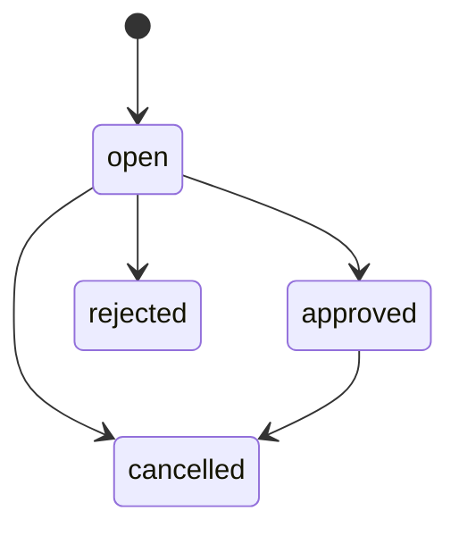

# Maintenance Task Management (v0.4.0)

## Arbeitsablauf

1. Gitea-Repositories über `POST /api/v1/repositories/sync` synchronisieren.
2. Ein Repository mit `POST /api/v1/repositories/{id}/analyze` lesend analysieren.
3. Wartungskandidaten über `POST /api/v1/tasks/import/{id}` importieren.
4. Aufgaben im Dashboard unter http://127.0.0.1:45000 sichten.
5. Tasks freigeben oder ablehnen. **Freigabe startet keinen Coding Agent.**

## Datenmodell

| Tabelle | Zweck |
|---|---|
| `schema_migrations` | Versionen der Datenbankstruktur |
| `maintenance_tasks` | Deduplizierte Wartungsaufgaben mit Repository, Priorität, Risiko, Akzeptanzkriterien und Status |
| `maintenance_task_events` | Unveränderliche Historie aller Statusänderungen |

Wartungsbefunde erhalten deterministische SHA-256-Fingerprints. Derselbe Befund wird nicht mehrfach als neuer Task angelegt. Bereits entschiedene Tasks werden durch einen erneuten Import nicht zurückgesetzt.

## API

| Methode | Route | Zweck |
|---|---|---|
| GET | `/api/v1/tasks` | Liste, optional `?status=open` |
| POST | `/api/v1/tasks/import/{id}` | Wartungsbefunde aus gespeichertem Analysebericht importieren |
| PATCH | `/api/v1/tasks/{id}/status` | Status mit JSON `{"status":"approved","reason":"Reviewed"}` ändern |
| GET | `/api/v1/tasks/{id}/history` | Audit-Historie anzeigen |

Alle Task-Endpunkte verlangen `X-Admin-Key`; der Wert stammt aus `ADMIN_API_KEY` in `.env`. Die UI fordert den Schlüssel pro Browser-Seite an und persistiert ihn nicht. Der Zugriff bleibt auf den lokalen Host beschränkt. Für echten Mehrbenutzerbetrieb sind rollenbasierte Sessions und CSRF-Schutz noch erforderlich.

## Zulässige Zustände

`approved` bedeutet ausschließlich zur späteren Bearbeitung freigegeben. Kein Git-Push, Docker-Run oder Agenten-Job wird ausgelöst.

## Migrationen

Das Backend verwendet ein versioniertes Migrationsregister unter PostgreSQL Advisory Lock, das bestehende Repository- und Analysedaten beibehält. Version 001: Katalog, 002: Analysen, 003: Maintenance Tasks und Audit. Rollback-Migrationen und eine eigenständige Migrations-CLI sind noch nicht enthalten.

## Grenzen und nächster Schritt

Diese Stufe nutzt weiterhin die vorhandene statische Dashboard-Oberfläche; **Nuxt 4 ist noch nicht integriert**. Noch offen sind Job-Queue, Redis-Worker, Sandbox-Executor, OpenCode, unabhängige Validierung, PR-Publisher und Mehrbenutzerberechtigungen. Die Aufgaben basieren auf heuristischen Befunden und stellen keinen CVE-Scan dar.


